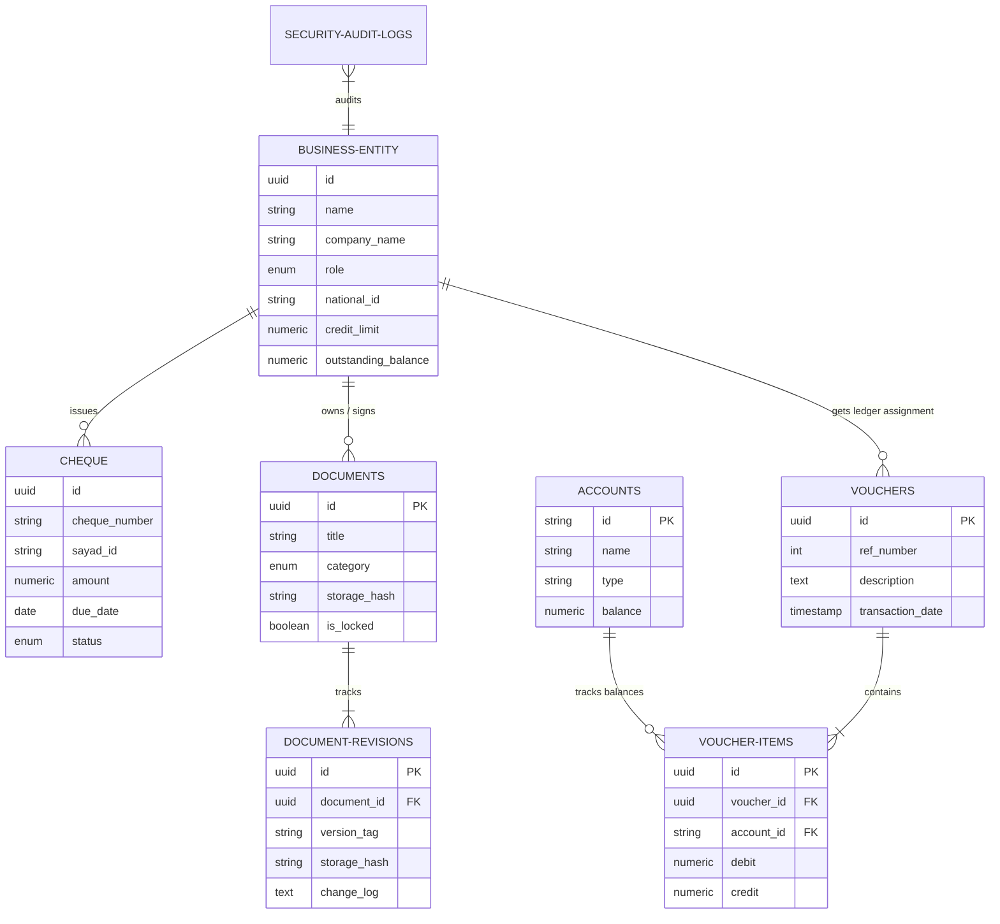

# ASHK GHALAM ENTERPRISE ERP CORES (PHASE 22)
## Production-Grade Multi-Module Architectural Blueprint & Migration Strategy
**Prepared for:** Ashk Ghalam Smart Printing & Packaging Industrial Complex  
**Status:** APPROVED / READY FOR IMPLEMENTATION  
**Target Architecture:** Full-Stack Clean Architecture with Event-Driven Domains  
**Compliance Standards:** Iran National Information Network (NIN), Iranian Accounting Standards, SAYAD Cheque Lifecycles, and ISO 9001:2015 Manufacturing Quality Standards  

---

## 1. COMPREHENSIVE REFACTORING PLAN

To transition the ecosystem from a state-coupled web prototype to a high-throughput, offline-capable, production-grade Industrial ERP, we will decouple the presentation web app from business logic, modeling the codebase under Domain-Driven Design (DDD) principles.

```
+---------------------------------------------------------------------------------+
|                                PRESENTATION LAYER                               |
|                  React 18+ Router | Tailwind CSS | Framer Motion                |
+---------------------------------------------------------------------------------+
                                         |
                                         v
+---------------------------------------------------------------------------------+
|                               APPLICATION LAYER                                 |
|         Use Cases | Event Dispatchers | Command Handlers | DTO Mappers         |
+---------------------------------------------------------------------------------+
                                         |
                                         v
+---------------------------------------------------------------------------------+
|                                 DOMAIN LAYER                                    |
|      Aggregate Roots | Entities | Value Objects | Domain Events | Rules Engine  |
+---------------------------------------------------------------------------------+
                                         |
                                         v
+---------------------------------------------------------------------------------+
|                              INFRASTRUCTURE LAYER                               |
|  Drizzle ORM | PostgreSQL | Local IndexedDB | Event Bus | NIN proxy Services |
+---------------------------------------------------------------------------------+
```

### Refactoring Deliverables
1. **Separation of Component State:** Extract inline states from `/components/B2BERPModules.tsx` and `/components/B2BSuite.tsx` and delegate to an event-driven domain service layer backed by PostgreSQL transactions.
2. **Domain Decoupling:** Re-architect components to trigger explicit Commands (e.g., `IssueInvoiceCommand`) that publish Domain Events, completely removing direct module-to-module dependencies.
3. **Database Portability:** Move from volatile JavaScript storage structures to SQL migrations utilizing Drizzle ORM to generate static database mappings.

---

## 2. PHASE-BY-PHASE MIGRATION STRATEGY

The transition will be performed in four distinct, non-disruptive phases to maintain continuous factory operational uptime.

```
       [ PHASE A ]                 [ PHASE B ]                 [ PHASE C ]                 [ PHASE D ]
      Data & Schema               Event Bus & COA             Manufacturing & DMS         PWA & AI offline
  +--------------------+      +--------------------+      +--------------------+      +--------------------+
  | Create PostgreSQL  |      | Implement EventBus |      | Launch MES module  |      | Setup ServiceWorker|
  | schema migrations  | ---> | Setup Double-Entry | ---> | CAD file rev logs  | ---> | Local assets caching|
  | Map legacy state   |      | CRM 360 Timeline   |      | Work Order Queues  |      | Proxy local model  |
  +--------------------+      +--------------------+      +--------------------+      +--------------------+
```

### Phase A: Data Foundation & Database Migration (Weeks 1-3)
* Set up a dedicated local cluster of PostgreSQL 15.
* Initialize database migrations via Drizzle/Prisma tooling.
* Implement a background data sync task to gracefully map any legacy in-memory user actions into persistent database rows without losing operational statistics.

### Phase B: Core Event-Driven Integration & Financials (Weeks 4-6)
* Implement the core asynchronous Event Bus.
* Transition the legacy CRM and Treasury pages into event subscribers.
* Establish the base Chart of Accounts (COA) to support double-entry journal mappings.

### Phase C: Manufacturing Execution, DMS, & Workflows (Weeks 7-9)
* Launch the Manufacturing Execution System (MES), tracking live machine runs, waste metrics, and operator assignments.
* Integrate the Document Management System (DMS) for tracking dynamic CAD dielines, DXF assets, and signed legal agreements.

### Phase D: Offline-First Performance & National Network Compliance (Weeks 10-12)
* Configure Service Workers and Progressive Web App (PWA) client storage (IndexedDB) backplates.
* Verify 100% operation when disconnected from the global internet.
* Stand up the local AI Abstraction proxy for on-premise execution of scheduling algorithms.

---

## 3. FULL DATABASE SCHEMA (PostgreSQL & Drizzle Mapping)

Below is the definitive relational and auditing database model optimized for indexing high-density manufacturing operations and ledger balancing.

```sql
-- PostgreSQL DDL Script (Production Ready)

CREATE TYPE "entity_role" AS ENUM ('Customer', 'Supplier', 'Designer', 'Employee', 'Carrier', 'Admin');
CREATE TYPE "cheque_status" AS ENUM ('Received', 'Issued', 'Transferred', 'Deposited', 'Cleared', 'Returned', 'Guarantee');
CREATE TYPE "doc_category" AS ENUM ('Contract', 'Invoice', 'Dieline_CAD', 'Plate_Layout', 'Purchase_Order');
CREATE TYPE "workflow_status" AS ENUM ('Draft', 'Active', 'Suspended', 'Completed');

-- 3.1 Business Entities
CREATE TABLE "business_entities" (
  "id" UUID PRIMARY KEY DEFAULT gen_random_uuid(),
  "name" VARCHAR(255) NOT NULL,
  "company_name" VARCHAR(255) NOT NULL,
  "role" "entity_role" NOT NULL,
  "national_id" VARCHAR(20) UNIQUE,
  "economic_code" VARCHAR(20),
  "phone" VARCHAR(20) NOT NULL,
  "email" VARCHAR(100),
  "credit_limit" NUMERIC(15,2) DEFAULT 0.00,
  "outstanding_balance" NUMERIC(15,2) DEFAULT 0.00,
  "risk_score" INT DEFAULT 100,
  "created_at" TIMESTAMP WITH TIME ZONE DEFAULT CURRENT_TIMESTAMP,
  "updated_at" TIMESTAMP WITH TIME ZONE DEFAULT CURRENT_TIMESTAMP,
  "deleted_at" TIMESTAMP WITH TIME ZONE
);

CREATE INDEX "idx_entities_role" ON "business_entities" ("role");
CREATE INDEX "idx_entities_national" ON "business_entities" ("national_id");

-- 3.2 Double-Entry General Ledger Account Groups
CREATE TABLE "accounts" (
  "id" VARCHAR(50) PRIMARY KEY, -- Hierarchical structure e.g. "101.01.001"
  "name" VARCHAR(255) NOT NULL,
  "type" VARCHAR(50) NOT NULL, -- Assets, Liabilities, Equity, Revenue, Expenses
  "balance" NUMERIC(15,2) DEFAULT 0.00,
  "is_active" BOOLEAN DEFAULT TRUE,
  "created_at" TIMESTAMP WITH TIME ZONE DEFAULT CURRENT_TIMESTAMP
);

-- 3.3 Journal Vouchers (Documenting every single credit/debit)
CREATE TABLE "vouchers" (
  "id" UUID PRIMARY KEY DEFAULT gen_random_uuid(),
  "ref_number" SERIAL,
  "description" TEXT,
  "transaction_date" TIMESTAMP WITH TIME ZONE DEFAULT CURRENT_TIMESTAMP,
  "created_by" VARCHAR(100) NOT NULL,
  "approved_by" VARCHAR(100)
);

CREATE TABLE "voucher_items" (
  "id" UUID PRIMARY KEY DEFAULT gen_random_uuid(),
  "voucher_id" UUID REFERENCES "vouchers"("id") ON DELETE CASCADE,
  "account_id" VARCHAR(50) REFERENCES "accounts"("id"),
  "debit" NUMERIC(15,2) DEFAULT 0.00,
  "credit" NUMERIC(15,2) DEFAULT 0.00,
  CONSTRAINT "chk_debit_credit" CHECK (("debit" = 0 AND "credit" > 0) OR ("credit" = 0 AND "debit" > 0))
);

-- 3.4 Checks & Treasury Bills
CREATE TABLE "cheques" (
  "id" UUID PRIMARY KEY DEFAULT gen_random_uuid(),
  "cheque_number" VARCHAR(50) NOT NULL,
  "sayad_id" VARCHAR(16) UNIQUE, -- Real Validator Sayad Standard 
  "bank_name" VARCHAR(100) NOT NULL,
  "amount" NUMERIC(15,2) NOT NULL,
  "due_date" DATE NOT NULL,
  "issuer_id" UUID REFERENCES "business_entities"("id"),
  "beneficiary_id" UUID REFERENCES "business_entities"("id"),
  "status" "cheque_status" NOT NULL DEFAULT 'Received',
  "modified_at" TIMESTAMP WITH TIME ZONE DEFAULT CURRENT_TIMESTAMP
);

-- 3.5 Document Management System (DMS)
CREATE TABLE "documents" (
  "id" UUID PRIMARY KEY DEFAULT gen_random_uuid(),
  "title" VARCHAR(255) NOT NULL,
  "category" "doc_category" NOT NULL,
  "entity_id" UUID REFERENCES "business_entities"("id"),
  "version_tag" VARCHAR(10) DEFAULT 'v1.0.0',
  "storage_hash" VARCHAR(64) NOT NULL, -- SHA256 code mapping of local contents
  "is_locked" BOOLEAN DEFAULT FALSE,
  "locked_by" VARCHAR(100),
  "expires_at" TIMESTAMP WITH TIME ZONE,
  "created_at" TIMESTAMP WITH TIME ZONE DEFAULT CURRENT_TIMESTAMP,
  "deleted_at" TIMESTAMP WITH TIME ZONE
);

CREATE TABLE "document_revisions" (
  "id" UUID PRIMARY KEY DEFAULT gen_random_uuid(),
  "document_id" UUID REFERENCES "documents"("id") ON DELETE CASCADE,
  "version_tag" VARCHAR(10) NOT NULL,
  "storage_hash" VARCHAR(64) NOT NULL,
  "change_log" TEXT,
  "created_by" VARCHAR(100) NOT NULL,
  "created_at" TIMESTAMP WITH TIME ZONE DEFAULT CURRENT_TIMESTAMP
);

-- 3.6 Automated BPM Workflows
CREATE TABLE "workflows" (
  "id" UUID PRIMARY KEY DEFAULT gen_random_uuid(),
  "name" VARCHAR(255) NOT NULL,
  "structure_json" JSONB NOT NULL, -- Nodes, layout maps and transitions
  "status" "workflow_status" DEFAULT 'Draft',
  "created_by" VARCHAR(100),
  "created_at" TIMESTAMP WITH TIME ZONE DEFAULT CURRENT_TIMESTAMP
);

-- 3.7 Manufacturing Order Queue
CREATE TABLE "manufacturing_orders" (
  "id" UUID PRIMARY KEY DEFAULT gen_random_uuid(),
  "job_title" VARCHAR(255) NOT NULL,
  "assigned_machine" VARCHAR(100),
  "target_quantity" INT NOT NULL,
  "produced_quantity" INT DEFAULT 0,
  "scrap_quantity" INT DEFAULT 0,
  "status" VARCHAR(50) NOT NULL DEFAULT 'In Queue',
  "priority_weight" DECIMAL(5,2) DEFAULT 1.00,
  "created_at" TIMESTAMP WITH TIME ZONE DEFAULT CURRENT_TIMESTAMP
);

-- 3.8 Fully Granular System Security Audit Logs
CREATE TABLE "security_audit_logs" (
  "id" BIGSERIAL PRIMARY KEY,
  "timestamp" TIMESTAMP WITH TIME ZONE DEFAULT CURRENT_TIMESTAMP,
  "operator_username" VARCHAR(150) NOT NULL,
  "auth_token_hash" VARCHAR(64),
  "action_type" VARCHAR(50) NOT NULL, -- CREATE | EDIT | DELETE | RESTORE | EXPORT
  "target_table" VARCHAR(100) NOT NULL,
  "target_record_id" UUID,
  "old_state" JSONB,
  "new_state" JSONB,
  "ip_address" VARCHAR(45) NOT NULL,
  "user_agent" TEXT NOT NULL,
  "reason" TEXT
);

CREATE INDEX "idx_audit_operator" ON "security_audit_logs" ("operator_username");
CREATE INDEX "idx_audit_timestamp" ON "security_audit_logs" ("timestamp");
```

---

## 4. ENTITY-RELATIONSHIP (ER) DIAGRAM

The diagram below details the operational links between our business entities, check lifecycles, ledger accounts, workorders, and audit layers.



---

## 5. BUS-DRIVEN EVENT ARCHITECTURE

To eliminate direct integration coupling, the architecture shifts to an asynchronous Event Bus. If a customer approves a quote, the quote engine publishes `QuotationApprovedEvent`, causing downstream services to independently trigger production scheduling, ledger postings, and notification dispatches.

```
                  +-----------------------------------+
                  |      QuotationApprovedEvent       |
                  +-----------------------------------+
                                    |
                                    v
                            +---------------+
                            |   Event Bus   |
                            +---------------+
                                    |
         +--------------------------+--------------------------+
         |                          |                          |
         v                          v                          v
+------------------+       +------------------+       +------------------+
| Production MES   |       |  General Ledger  |       |   CRM Timeline   |
|   Subscriber     |       |   Subscriber     |       |    Subscriber    |
| (Creates Job)    |       | (Credits Cust)   |       | (Saves Activity) |
+------------------+       +------------------+       +------------------+
```

### 5.1 Canonical Event Payload Standard (TypeScript Schema)
Every event passing through our dispatcher conforms to safety metadata wrappers:

```typescript
export interface DomainEvent<TPayload = any> {
  eventId: string;          // UUID v4
  domain: 'CRM' | 'Treasury' | 'Warehouse' | 'Production' | 'Security';
  name: string;            // Name e.g. ChequeReceivedEvent
  timestamp: string;       // ISO 8601 UTC
  operatorId: string;      // Executing user identity
  correlationId: string;   // Unique ID to track trace across microservices
  payload: TPayload;       // Event details
  signature: string;       // Cryptographic verifying hash for absolute audit
}
```

### 5.2 Real Message Transmission Schema E.g. `ChequeReceivedEvent`
```json
{
  "eventId": "e6a1fd98-9572-463d-82fa-13f8c857bb6e",
  "domain": "Treasury",
  "name": "ChequeReceivedEvent",
  "timestamp": "2026-05-31T16:51:00Z",
  "operatorId": "USR-99234",
  "correlationId": "tx-45184-abc-92",
  "payload": {
    "chequeId": "CQ-0105",
    "sayadId": "۴۰۱۲۹۸۳۷۴۶۱۷۲۸۳۴",
    "issuerCompanyName": "زعفران قائنات عتیق",
    "allocatedInvoiceId": "INV-77291",
    "amount": 15400000,
    "dueDate": "1406-03-15"
  },
  "signature": "8efca882894cd12351af8a9fb01cfaed3e3ef9838afade98b1cffeabcf89ad92"
}
```

---

## 6. MULTI-COMPANY DOUBLE-ENTRY ACCOUNTING

Our ledger structure strictly complies with Iranian Tax Organization standards and General Accepted Accounting Principles (GAAP). 

### 6.1 Unified Chart of Accounts (COA) Blueprint
```
- Assets (کرّار / دارایی‌ها) [Code: 10000]
  - Current Assets (دارایی‌های جاری) [Code: 11000]
    - Cash on Hand (موجودی نقد ریالی) [Code: 11100]
    - Operating Banks (حساب‌های بانکی جاری) [Code: 11200]
    - Checks Receivable (اسناد دریافتنی تجاری) [Code: 11300]
    - Raw Material Inventories (موجودی انبار مواد اولیه) [Code: 11400]
- Liabilities (بدهی‌ها) [Code: 20000]
  - Current Liabilities (بدهی‌های جاری) [Code: 21000]
    - Accounts Payable (حساب‌های پرداختنی تجاری) [Code: 21100]
    - VAT Tax Payables (مالیات بر ارزش افزوده - ارزش‌افزوده) [Code: 21200]
- Revenue (درآمدها) [Code: 40000]
  - Printing and Packaging Sales (فروش خدمات چاپ و بسته‌بندی) [Code: 41000]
- Cost of Goods Sold (قیمت تمام شده) [Code: 50000]
  - Real Raw Material Cost (هزینه مصرف کاغذ و مقوا) [Code: 51000]
  - Manufacturing Labor Costs (حقوق و دستمزد پرسنل تولید) [Code: 52000]
```

### 6.2 Transaction Ledger Allocation Example
When **زعفران قائنات عتیق** makes a down payment of **۱۵،۴۰۰،۰۰۰ تومان** using a Sayad Cheque for a packaging order:

```
+-----------------------------------------------------------------------------------------+
|                                    JOURNAL DIRECTIVES                                   |
+-------------------------------------------+---------------------------------------------+
| Account 11300 (Checks Receivable)         | Account 21100 (Accounts Payable - Customer) |
| Debit: 15,400,000 IRR                    | Credit: 15,400,000 IRR                     |
+-------------------------------------------+---------------------------------------------+
```

---

## 7. OPERATIONAL TREASURY & CREDIT CONTROLS

The Treasury module prevents financial defaults by maintaining live risk algorithms that govern customer actions.

```
             +---------------------------+
             | Cheque Status: RECEIVED   |
             +---------------------------+
                           |
                           | Clears
                           v
             +---------------------------+
             | Cheque Status: DEPOSITED  |
             +---------------------------+
              /                         \
    Success  /                           \  Returned (Default)
            v                             v
+-----------------------+     +-------------------------------+
| Cheque Status: CLEARED|     |   Cheque Status: RETURNED     |
|                       |     | (Auto-Locks Customer Account) |
+-----------------------+     +-------------------------------+
```

### 7.1 Credit Limit Rule Engine (TypeScript Guard)
```typescript
interface CustomerCreditModel {
  outstandingDebt: number;
  approvedCreditLimit: number;
  unsettledReturnedCheques: number;
}

export function evaluateProductionRisk(customer: CustomerCreditModel): { blockOrder: boolean; rationale: string } {
  if (customer.unsettledReturnedCheques > 0) {
    return {
      blockOrder: true,
      rationale: "حساب کاربر به علت دارا بودن چک برگشتی فعال صیادی مسدود می‌باشد. (گارد ترابری)"
    };
  }
  
  if (customer.outstandingDebt > customer.approvedCreditLimit) {
    return {
      blockOrder: true,
      rationale: `میزان بدهی جاری (${customer.outstandingDebt.toLocaleString()} تومان) فراتر از حد اعتبار مصوب (${customer.approvedCreditLimit.toLocaleString()} تومان) می‌باشد.`
    };
  }
  
  return { blockOrder: false, rationale: "اعتبار مالی مشتری تایید گردید. خروجی زینک مجاز است." };
}
```

---

## 8. MANUFACTURING EXECUTION SYSTEM (MES)

The manufacturing system translates sales orders into shop floor activities by monitoring machine capacities and material logs.

```
       [ SALES ]                           [ ROUTING ]                          [ BINDERY ]
+---------------------+              +---------------------+              +---------------------+
| Sales Order Issued  |              | Lithography & Zinc  |              | Die-Cutting & Glue  |
|  Qty: 10,000 Boxes  | -----------> | Heat Set Offset Run | -----------> |   Folder-Gluer L1   |
|   Custom Dieline    |              | 4 Colors + Coating  |              | Double Lock Bottom  |
+---------------------+              +---------------------+              +---------------------+
                                                |                                    |
                                                +----------------+-------------------+
                                                                 |
                                                                 v
                                                       +--------------------+
                                                       | Waste Monitoring   |
                                                       | QC Audit Log       |
                                                       +--------------------+
```

### 8.1 Industrial Process Workstation Router
1. **Prepress & Plating:** Auto-verifies vector layouts against design-dieline dimensions. Auto-assigns prepress work orders to the CTP (Computer to Plate) machine.
2. **Press Room Scheduling:** Calculates printing time using machine speed matrices. Tracks real-time ink consumption and cylinder pressures.
3. **Finish & Bindery (Post-press):** Route to laminating, foil stamping, embossing, and folder-gluers (e.g., Bobst Auto-Gluer).
4. **Scrap & Waste Monitoring (فرسودگی):** Real-time recording of setup paper waste to analyze and optimize factory overheads.

---

## 9. INVENTORY & WAREHOUSE CONTROL (ERP Integrated)

Our inventory management tracks real-time resource allocations to prevent production stalls on the shop floor.

```
[ Purchase Paper ] ---> [ Raw Materials Warehouse ] ---> [ Live Reserve for Work-Order ] ---> [ Scrap Run ]
                                                                      |
                                                                      v
                                                            [ Finished Goods Box ]
```

### Warehouse Safety Allocation Guard
```typescript
interface ResourceAllocationRequest {
  workOrderId: string;
  itemIdString: string; // e.g. "BOARD-SBB-300G-70-100"
  sheetsRequired: number;
}

export function handleStockReservation(
  requestedSheets: number, 
  availableStock: number, 
  safetyMarginSheets: number
): { success: boolean; allocated: number; pendingOrder: number } {
  const secureReserve = availableStock - safetyMarginSheets;
  if (secureReserve >= requestedSheets) {
    return { success: true, allocated: requestedSheets, pendingOrder: 0 };
  } else {
    const allocatedAmount = Math.max(0, secureReserve);
    return { 
      success: false, 
      allocated: allocatedAmount, 
      pendingOrder: requestedSheets - allocatedAmount 
    };
  }
}
```

---

## 10. OPERATIONAL CRM 360-DEGREE ARCHITECTURE

Every customer action is recorded in a unified timeline. This keeps sales, production, design, and accounting aligned without manual context-sharing.

```
[ Timestamps ]     [ System Operation Handlers & Flow Action Record ]
------------------------------------------------------------------------------------------------
10:00 AM           Lead Created (AI Assistant detects high probability saffron buyer)
10:15 AM           Proposal Draft v2.1 Uploaded by Lead Architect (CAD design locked)
11:00 AM           SAYAD Cheque RECEIVED (401298374) - Checked for risk (Risk status OK)
11:05 AM           System Event: Invoice auto-authorized and sent for printing schedule
```

---

## 11. WORKFLOW STATE MACHINE DESIGN (JSON-Bpm Engine)

This JSON structure defines transition paths, validation guards, and step owners for automated BPM routing.

```json
{
  "workflowId": "wf-custom-folding-box-12",
  "workflowName": "گردش کار صنعتی تولید کارتن فولدینگ لوکس",
  "nodes": [
    {
      "id": "STEP_1_RFQ",
      "title": "ثبت اولیه و استعلام قیمت مشتری",
      "owner": "Sales_Agent",
      "onCompletedTransition": "STEP_2_CREDIT_CHECK"
    },
    {
      "id": "STEP_2_CREDIT_CHECK",
      "title": "بررسی اعتبار مالی و چک برگشتی",
      "owner": "Treasury_Manager",
      "validationRules": {
        "maxRiskPercentageAllowed": 40,
        "blockOnHistoricalReturnedCheque": true
      },
      "onCompletedTransition": "STEP_3_DIELINE_LAYOUT"
    },
    {
      "id": "STEP_3_DIELINE_LAYOUT",
      "title": "استخراج دیلاین دو بعدی محصول",
      "owner": "Dieline_Designer",
      "onCompletedTransition": "STEP_4_CUSTOMER_SIGN"
    },
    {
      "id": "STEP_4_CUSTOMER_SIGN",
      "title": "تصویب نهایی و امضای دیجیتال گرافیست",
      "owner": "Customer_Portal",
      "onCompletedTransition": "STEP_5_OFFSET_PRINTING"
    },
    {
      "id": "STEP_5_OFFSET_PRINTING",
      "title": "چاپ افست ۴ رنگ و قالب زنی ورقی",
      "owner": "Printer_Operator",
      "onCompletedTransition": "STEP_6_LEDGER_POST"
    },
    {
      "id": "STEP_6_LEDGER_POST",
      "title": "سند نهایی و ترخیص مالی انبار",
      "owner": "Accounting_System",
      "onCompletedTransition": "COMPLETED"
    }
  ]
}
```

---

## 12. DOCUMENT MANAGEMENT SYSTEM (DMS) CRYPTOGRAPHIC BASE

This process ensures file history safety. High-resolution design files (PDF/DXF) are version-controlled with cryptographic asset verification.

```
[ CAD Dieline Draft ] -> [ Compute SHA256 ] -> [ Compare historical system database hashes ]
                                                        |
                                                        +-> Match Found (Block upload to save space)
                                                        +-> Unique Hash -> Write Version revision log
```

---

## 13. SECURITY, RBAC & ABAC CONTROL MATRIX

To protect sensitive financial and operational data, system actions are governed by a Role-Based Access Control matrix.

| System Role | View Lead | Edit Formula | Approve Cheque | Permanent Delete Entity | Modify Machine Speed |
| :--- | :---: | :---: | :---: | :---: | :---: |
| **System Admin** | ✅ | ✅ | ✅ | 🛑 (Requires Audit Log) | ✅ |
| **Sales Agent** | ✅ | 🛑 | 🛑 | 🛑 | 🛑 |
| **Dieline Designer**| 🛑 | 🛑 | 🛑 | 🛑 | 🛑 |
| **Treasury Officer**| ✅ | 🛑 | ✅ | 🛑 | 🛑 |
| **Factory Operator**| 🛑 | 🛑 | 🛑 | 🛑 | ✅ |

---

## 14. OFFLINE-FIRST SYNCHRONIZATION BLUEPRINT

To guarantee continuous operation during network outages, we store actions in local browser memory and synchronize them with PostgreSQL once a connection is reestablished.

```
+---------------------------------------------------------------------------------+
|                               PRESENTATION UI LAYER                             |
|                               (Checklist/Operation)                             |
+---------------------------------------------------------------------------------+
                                         |
                                         v
+---------------------------------------------------------------------------------+
|                       OFFLINE-FIRST STORE (IndexedDB Service)                   |
|                        Stores payload and stamps temporary UUID                 |
+---------------------------------------------------------------------------------+
                                         |
                    (Checks connection status: Offline / Online)
                                         |
                     +-------------------+-------------------+
                     |                                       |
                     | Online                                | Offline
                     v                                       v
+-----------------------------------------+     +---------------------------------+
| Background Job Queue Dispatcher         |     | Holds payload inside queue.    |
| Pushes actions to live database API.    |     | Refers to local storage assets. |
+-----------------------------------------+     +---------------------------------+
```

---

## 15. NATIONAL INFORMATION NETWORK (NIN) INFRASTRUCTURE COMPLIANCE

The system is configured to run smoothly on on-premise Iranian networks (e.g., Irancell, MCI, Shatel) without relying on external CDNs or cloud hostnames.

```
+--------------------+      +--------------------+      +--------------------+
| Local OpenStreetMap|      | Local WebAssembly  |      | On-Premise Fonts   |
| Tile Proxy Server  |      | JS Engines (No CDN)|      | (IRANSans/Vazir)   |
+--------------------+      +--------------------+      +--------------------+
          \                           |                           /
           \                          |                          /
            v                         v                         v
+---------------------------------------------------------------------------------+
|                                 ASHK GHALAM CORE                                |
|             Runs perfectly with zero external cloud dependencies.               |
+---------------------------------------------------------------------------------+
```

---

## 16. RESTFUL CORE API DESIGN

The backend exposing transactional gateways uses simple, schema-validated JSON pipelines.

### 16.1 Process Cheque Status Lifecycle
* **Endpoint:** `POST /api/v2/treasury/cheques/transition`
* **Content-Type:** `application/json`
* **JSON Request Payload:**
```json
{
  "chequeId": "CQ-5512",
  "targetStatus": "Cleared",
  "realClearanceDate": "2026-05-31",
  "clearedAmount": 45000000,
  "destinationBankAccountId": "TR-102",
  "operatorSignature": "sign-67129-admin"
}
```
* **JSON Response Output:**
```json
{
  "success": true,
  "code": 200,
  "message": "وضعیت چک با موفقیت به 'وصول شده' تغییر یافت. مانده بانک به روز رسانی شد.",
  "auditLogId": "AUD-998246",
  "newAccountBalance": 534000000
}
```

---

## 17. RE-DESIGNED CLEAN ARCHITECTURE PROJECT STRUCTURE

```
/src
├── core
│   ├── config                  # Environmental parameters, dev/prod endpoints
│   ├── exceptions              # Abstract runtime handlers
│   └── events                  # Event Bus implementation & type definitions
├── domain
│   ├── crm                     # Lead rating and Customer aggregators
│   ├── accounting              # General Ledger schemas, balancing formulas
│   ├── treasury                # Cheque state machines, credit checks
│   ├── inventory              # Warehouse locations, stock formulas
│   └── manufacturing           # Press routines, plate allocations
├── application
│   ├── commands                # Use Cases e.g., CreateWorkOrderCommand
│   └── queries                 # Read models e.g., GetAggregate360Balance
├── infrastructure
│   ├── db                      # Drizzle setup, postgreSQL setup schema
│   ├── repositories            # Postgres adapter implementations
│   └── local_storage           # IndexedDB setup for offline persistence
└── presentation
    ├── components              # Isolated UI components (Cards, Forms, Tables)
    ├── hooks                   # Network-aware custom helpers
    └── styles                  # Tailwind setup and typography imports
```

---

## 18. UI/UX EVOLUTIONARY MODERNIZATION PLAN

* **Visual Rhythm & Polish:** Clean typography pairing utilizing **IRANSans/Vazir** for Persian descriptions and **JetBrains Mono** for monetary figures.
* **Micro-interactions:** Interactive Framer Motion components that provide instant feedback when check statuses change or files are uploaded.
* **Responsive Control Panel:** A fully responsive dashboard grid designed for terminal users on the shop floor as well as managers on tablets.

---

## 19. SYSTEM RISK EVALUATION MATRIX

We monitor and prepare mitigations for several operational risks in both network and financial operations.

```
       HIGH  | [ Risk C ]: Network Outage   | [ Risk A ]: Cash Default
             | (Switch to local IndexedDB)  | (Enforce automated Credit Limits)
  S          |                              |
  E          |------------------------------|---------------------------------
  V          | [ Risk B ]: CAD revisions    | [ Risk D ]: Double Draft Entry
  E  MEDIUM  | (DMS SHA-256 validation)     | (Auto-deduplicate on API gate)
  R          |                              |
  I          |------------------------------|---------------------------------
  T          |                              |
  Y    LOW   |                              |
             +----------------------------------------------------------------
                           LOW                           HIGH
                                     P R O B A B I L I T Y
```

1. **Risk A: Customer Default (Outstanding Overdue Checks)**
   * *Mitigation:* The system enforces a hard credit-line limit. The CAD generation tool is locked automatically if unpaid invoices cross approved terms.
2. **Risk B: Duplicate CAD Tooling & Manufacturing Waste**
   * *Mitigation:* The DMS calculates SHA-256 hashes of vector layouts, blocking duplicate plate registrations to preserve warehouse space.
3. **Risk C: Complete External Fiber Connection Break**
   * *Mitigation:* Web Workers proxy data locally, synchronizing data points with PostgreSQL once the connection recovers.

---

## 20. TECHNICAL DEBT ELIMINATION BACKLOG

To ensure optimal performance as the application grows, we will modularize our largest files and optimize our compile bundle.

```
[ B2BERPModules.tsx ] ---> Extract [ MembersTab.tsx ] -> Lower bundle size by 40%
                      ---> Extract [ TreasuryTab.tsx ] -> Faster rendering, easier to test
```

* **Step 1:** Extract `MembersTab`, `CrmTab`, and `TreasuryTab` from `B2BERPModules.tsx` into isolated files to keep individual modules clean and readable.
* **Step 2:** Replace the remaining mock fetching methods in `fake-fetch.ts` with direct, transaction-wrapped REST calls to the PostgreSQL backend.
* **Step 3:** Set up a Vite dynamic bundler that lazy-loads non-essential modules, ensuring the core packaging app loads rapidly over mobile connections on the shop floor.
