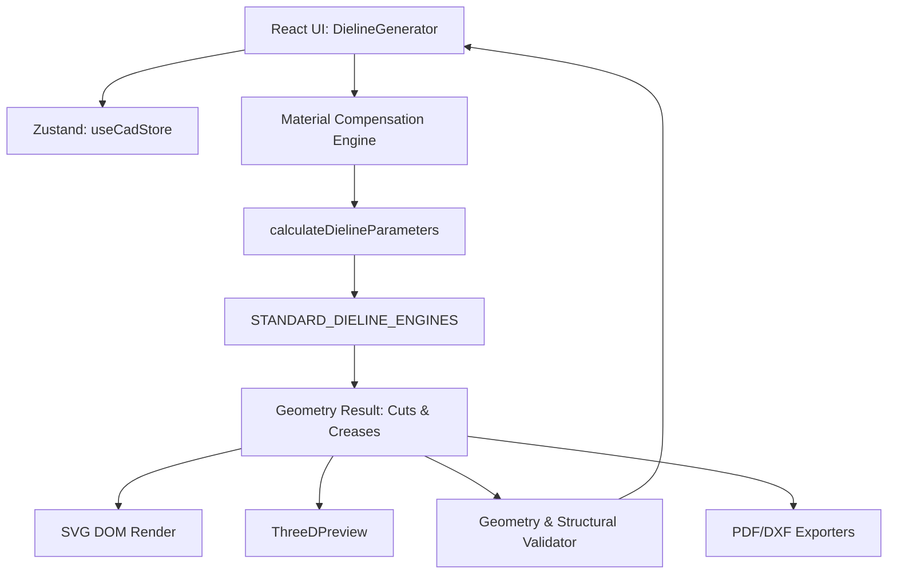

# DIELINE SYSTEM DEEP ANALYSIS & ARCHITECTURE EXTRACTION
*Phase 0 & Phase 1 Engineering Inventory*

## 1. SYSTEM INVENTORY

### Core Files & Modules
- **UI & Orchestration**: `/components/DielineGenerator.tsx` (Monolithic ~4900 lines)
- **Geometry & Math Engine**: `/services/dielineMath.ts` (1500+ lines)
- **3D Rendering**: `/components/ThreeDPreview.tsx`
- **Validators**: `/services/geometryValidator.ts`, `/services/structuralValidation.ts`, `/services/standardsEngine.ts`
- **Materials**: `/services/materialCompensationEngine.ts`
- **State Management**: `/store/useCadStore.ts`

### Implemented Templates
**FEFCO Standards:**
- `fefco-0201` (RSC)
- `fefco-0200` (Open-top)
- `fefco-0203` (Full Overlap)
- `fefco-0215` (Crash Lock Auto-Bottom)
- `fefco-0300` (Telescopic 2-piece)
- `fefco-0320` (Outside Retract Fold)
- `fefco-0426` (Pizza Box Classic)
- `fefco-0427` (Mailer Box Pro / Keyboard)
- `fefco-0409` (Wrap-around)
- `fefco-0470` (Die-cut self-locking)
- `fefco-0713` (Crash lock base)

**ECMA Standards:**
- `ecma-a2020` (Standard Tuck End)
- `snap-lock-123` (1-2-3 Bottom)
- `ecma-a30` (Peg Hanger)
- `ecma-b10` (Tubular Sleeve)
- `ecma-c1020` (Matchbox Drawer)
- `ecma-d50` (Countertop Display)

### Mathematical Pipeline
1. **Material Compensation**: `L_eff = L + thickness + foldLoss`
2. **Parameters Extraction**: `calculateDielineParameters(L, W, H)` computes `glueTab`, `tuck`, `dustFlap` using standard ratios (e.g., `tuck = Math.min(30, W * 0.3)`).
3. **Small Box Heuristics**: Applies scaling factors if `L < 80`, `W < 40`, or `H < 20`.
4. **Coordinate Plotting**: Calculates primary vertices (`x1, x2, x3...` and `y1, y2, y3...`) based on sequential addition of panel widths/lengths.
5. **Structural Integrity**: `simulateBoxCompressionStrength` uses McKee's formula: `BCT = 5.874 * ECT * sqrt(thickness * perimeter)`.

---

## 2. ARCHITECTURE MAP

---

## 3. CURRENT PROBLEMS (CRITICAL)

| Issue | Description | Risk Level |
| :--- | :--- | :--- |
| **Monolithic Component** | `DielineGenerator.tsx` handles UI, nesting, AI chat, pricing, state, and SVG rendering in 4900+ lines. | CRITICAL |
| **Missing AST** | Geometry engine outputs raw SVG string arrays (`M ... L ... Z`). No geometric abstraction exists. | CRITICAL |
| **Mixed Responsibilities** | `dielineMath.ts` handles math, routing, SVG generation, and styling simultaneously. | HIGH |
| **Static Topology** | Topologies are hardcoded. Cannot programmatically mix a "Crash Bottom" with a "Tuck Top" without writing a completely new template. | HIGH |
| **Hardcoded Drawing** | Inline functions like `drawTuckFlap` are duplicated across multiple templates inside `dielineMath.ts`. | MEDIUM |
| **Export Limitations** | Since output is raw SVG strings, generating true DXF or ArtiosCAD formats requires fragile string parsing. | CRITICAL |

---

## 4. GEOMETRY ANALYSIS

- **Panel Calculations**: Handled via absolute cumulative coordinates (`x1 = x0 + glueTab`, `x2 = x1 + W`, etc.). This approach is rigid.
- **Flap Logic**: Dust flaps and tuck flaps are drawn using inline helper functions (`drawDustFlap`, `drawTuckFlap`) that hardcode 15° tapers (`dH * 0.268`).
- **Glue Logic**: Employs standard folder-gluer tapers (45° chamfers) and exact circular arcs for smooth transitions.
- **Cut/Crease Differentiation**: Driven purely by array assignment (`cuts.push(...)` vs `creases.push(...)`). No edge-graph topology exists.

---

## 5. TEMPLATE SYSTEM ANALYSIS

- **Selection**: Hardcoded object dictionary (`STANDARD_DIELINE_ENGINES`).
- **Nature**: Parametric dimensions (L,W,H), but completely static topologies.
- **Scaling Limits**: Adding 500 templates will bloat `dielineMath.ts` to ~50,000 lines. The system lacks a template registry and dynamic loading.

---

## 6. SVG PIPELINE

- **Generation**: Direct string concatenation.
- **Path Construction**: No AST or object-oriented paths. E.g., ``cuts.push(`M ${x1},${y} L ...`)``.
- **Layers**: Managed in React state, but physically rendered as separate SVG `<g>` groups based on array classification.

---

## 7. THREE.JS PIPELINE

- **Conversion**: Relies on parsing the raw SVG paths, triangulating them (likely via earcut or Three.js ShapePath), and assigning fold hinge axes.
- **Simulation**: Uses kinematic hinge rotations based on slider values (`foldRatio`).
- **Physics**: Fake kinematics. No actual collision detection or material stress/bending physics during folding.

---

## 8. DATA FLOW LIFECYCLE

1. User alters Dimension/Material in UI.
2. `useCadStore` updates state.
3. React re-renders `DielineGenerator`.
4. `useMemo` triggers `calculateMaterialCompensation`.
5. Adjusted dimensions sent to `STANDARD_DIELINE_ENGINES[id]`.
6. Raw SVG paths generated.
7. Paths fed to `GeometryValidator`.
8. Validated paths rendered in `<svg>` and sent as props to `<ThreeDPreview>`.

---

## 9. REFACTOR READINESS SCORE

| Metric | Score | Justification |
| :--- | :--- | :--- |
| **Architecture Quality** | 20/100 | Highly monolithic, tight coupling between math and presentation. |
| **Scalability** | 15/100 | Adding templates or output formats is O(N) manual hardcoding. |
| **Maintainability** | 25/100 | 4900-line files make debugging extremely difficult. |
| **CAD Correctness** | 85/100 | Excellent use of industry standards, 15° tapers, and precision compensation. |
| **Extensibility** | 10/100 | Zero plugin architecture, no AST, no decoupling. |

**Overall Kernel Score: 31/100**
*Conclusion: The mathematical logic is excellent, but the software architecture requires a complete rewrite (Phase 1) to transition from a "React App" to a "CAD Kernel".*
