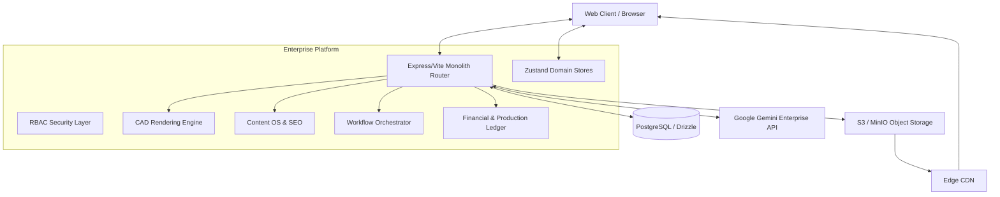

# ENTERPRISE REFACTORING DIRECTIVE
# ASHK GHALAM ERP / DXP / CAD PLATFORM
**Date:** 2026-06-04
**Audience:** Principal Software Architects, Product Owners, Engineering Leads
**Reference:** `ARCHITECTURE_AUDIT.md`

This document serves as the absolute blueprint for transforming the Ashk Ghalam platform from an MVP monolithic application into an Enterprise-Grade Digital Experience Platform (DXP), Packaging Engineering System, and ERP.

---

## 1. Technical Debt Report

### Critical Debt (Requires Complete Rebuild)
1.  **State Management (Context API Overload):** Heavy reliance on `AuthContext.tsx` and `ContentContext.tsx` for deeply structured, high-frequency mutating data (ERP ledgers, CAD coordinates). This causes complete component tree re-renders and memory bloat.
2.  **Mock / Visual CAD Engine:** Current CAD relies on visual drawing approximation rather than mathematical parametrics. Lack of true FEFCO/ECMA algorithmic derivation leads to un-manufacturable dieline outputs.
3.  **Fragmented Extraneous CMS Structures:** The existence of both `/cms/` (legacy) and `/dxp/` (v2) directories indicates architectural divergence. Content types are hardcoded instead of dynamically decoupled.
4.  **Local Ephemeral Storage:** Utilizing Express `multer` and the local file system (`/uploads/`) prevents horizontal container scaling (Docker/Kubernetes).
5.  **ERP Missing Workflow Engine:** Order statuses rely on hardcoded enums rather than a true Business Process Management (BPM) state-machine model.

### Maintainable Debt (Requires Optimization)
1.  **ERP Data Mutations:** Monolithic query handlers instead of separated Command Query Responsibility Segregation (CQRS) paths.
2.  **Database Queries:** Missing materialized views for heavy aggregated financial reports.
3.  **Backup System:** Current full-snapshot backup is reliable but does not support differential/incremental chaining, creating massive I/O load on scale.

---

## 2. Rebuild Roadmap

### Phase 1: State & Storage Foundation (P1/P2)
*   **Action 1.1:** Integrate Zustand (or Redux Toolkit) for strict Domain-Driven Stores (`useCadStore`, `useErpStore`, `useCmsStore`).
*   **Action 1.2:** Deprecate local file storage. Implement Object Storage Layer (S3 Protocol / MinIO) with CDN Edge caching and signed URL lifecycle management.
*   **Action 1.3:** Purge legacy `/cms/`. Migrate all structures entirely to the unified Headless CMS Engine.

### Phase 2: CAD Engineering Reboot (P1)
*   **Action 2.1:** Implement the Parametric Constraint Engine.
*   **Action 2.2:** Scaffold the FEFCO & ECMA master algorithmic databases.
*   **Action 2.3:** Transition the CAD UI away from dashboard restrictions into a true Canvas-First Glass UI workspace.

### Phase 3: The BPM Workflow Engine (P1)
*   **Action 3.1:** Introduce a central State Machine for sales, approval, production, and QC routing.

### Phase 4: Enterprise SEO Platform (P2)
*   **Action 4.1:** Establish the programmatic page generation matrix structure.
*   **Action 4.2:** Build the Topical Authority internal linking logic.

---

## 3. Optimization Roadmap

*   **Database (P3):** Implement PostgreSQL indexes on frequent cross-joins (e.g., `user_id` + `content_entry_id`). Introduce materialized views for B2B financial dashboards.
*   **ERP Core (P3):** Introduce CQRS domain service layers (e.g., separating `PricingReadService` from `CostCommandService`).
*   **AI Integration (P3):** Provide the existing `@google/genai` implementation with strict enterprise system prompting for localized SEO and packaging engineering consultancy.
*   **Backups (P3):** Refactor the reliable continuous backup to output incremental `.diff` payloads to reduce overhead.

---

## 4. New Architecture Diagram

---

## 5. Domain Diagram (DDD Bounded Contexts)

1.  **Packaging Engineering Context:** Parametric models, standard (FEFCO/ECMA) definitions, materials compensation, 2D/3D topological data.
2.  **Commercial Context:** CRM, Invoicing, B2B treasury, automated lithography print costing.
3.  **Orchestration Context:** BPM State machine, Kanban boards, QC approval chains.
4.  **Digital Experience Context:** Headless content types, media assets (DAM), localized SEO grids, tracking.
5.  **Platform Core:** Auth, IAM, Event Logging, Backups.

---

## 6. Data Flow Diagram

**Standard Mutation Flow:**
1. Action initiated via Command UI.
2. Action hits Zustand Dispatcher.
3. Authenticated RPC/REST request fires to `<Domain>Service`.
4. Command Validation & Structural Check.
5. Drizzle ORM executes transaction in PostgreSQL.
6. Trigger event updates Materialized Views.
7. Return payload updates Local Zustand Store.

**File Payload Flow:**
1. Client requests Signed Upload URL from API.
2. Direct Upload from Client to S3/MinIO bucket.
3. Webhook/Return payload triggers DAM Record creation in PostgreSQL tagging optimization status.

---

## 7. UI Architecture Diagram

**Modality Split:**
The system must never mix the "Dashboard" paradigm with the "Creation" paradigm.

*   **Mode A (Dashboards/Admin):**
    *   Standard responsive Side-nav / Sticky Header.
    *   List views, tables, bento-grid analytics.
*   **Mode B (CAD WebGL Workspace):**
    *   `100vw` / `100vh` Canvas container.
    *   Left side: Auto-hiding Dockable Tool/Layer pane.
    *   Right side: Property Inspector & Metrics.
    *   Bottom: Interactive Minimap.
    *   The dieline geometry is absolute and remains visible under glass-morphism panels.

---

## 8. CMS Architecture Diagram

**Unified Headless Content OS:**

*   `Schema Builder:` Admins define raw data structures dynamically (Strings, Booleans, Rich Text, Relationships).
*   `Workflow Controller:` Draft -> Review -> Approved -> Published.
*   `Localization Layer:` Enforced generic multi-locale dictionary.
*   `Delivery API:` Rest/GraphQL gateway for external syndication.

---

## 9. SEO Architecture Diagram

**SEO OS:**
*   `Technical Scanner:` Background cron checks for LCP/CLS metrics and orphaned graphs.
*   `Programmatic Engine:` Permutation Matrix Builder `[Variables] x [Intent] = Scale`.
*   `Semantic Mapper:` Maps keywords directly to content schema tags.
*   `Metadata Injector:` React Helmet / Document head hydration.

---

## 10. CAD Architecture Diagram

**Packaging Engineering Stack (P1 REBUILD):**
1.  **Input:** User selects standard (e.g., ECMA 0205) + LxWxH + Thickness.
2.  **Algorithmic Engine:** Applies mathematical rule-set. Calculates cut trajectories and crease lines based on flute compensation matrices.
3.  **Tolerance Engine:** Checks if `Fold 1` overlaps `Glue Tab 2`. Auto-corrects based on predefined logic.
4.  **Export Layer:** Transforms mathematical vector array into strict JSON representations, DXF, or PDF.
5.  **Render Layer (Canvas):** Interprets JSON to draw responsive paths in the UI.

---

## 11. Workflow Engine Architecture

**BPM Core State Machine:**

Transitions must be explicitly defined to avoid illegal states.
*   `State:` **Inquiry Received**
*   `Transition:` *Estimator Reviews* -> **Priced Request**
*   `Transition:` *Client Approves* -> **Awaiting Design**
*   `Transition:` *Designer Uploads CAD* -> **Pending structural check**
*   `Transition:` *Approved* -> **Production Queue (Litho)**
*   `Transition:` *QC Passed* -> **Dispatched**

---

## 12. Migration Strategy

**Strangler Fig Application Strategy:**
1.  **Phase 1 (Dual State):** Initialize Zustand stores alongside Context. Map all new components to Zustand.
2.  **Phase 2 (Content Port):** Spin up unified Headless CMS. Write a backend script to transform legacy `/cms` postgres rows into the new schema format. Update routes.
3.  **Phase 3 (S3 Transition):** Provision MinIO/S3. Re-write the DAM upload resolver. Run a one-off script to push all local `/uploads/` to the cloud bucket, rewriting database URL references simultaneously.
4.  **Phase 4 (CAD Overhaul):** Build the new Canvas-First component on a separate route `/engineering`. Deprecate old `/design-studio` once parity is reached.

---

## 13. Risk Assessment

| Risk | Probability | Impact | Mitigation Strategy |
| :--- | :--- | :--- | :--- |
| **S3 Latency on Print Servers** | Medium | High | Utilize local Edge-caching CDNs and webP aggressive compression prior to storage. |
| **Old CAD File Incompatibility** | High | Critical | Build a legacy-parser layer in the new CAD Engine that interpolates old visual coordinates into pseudo-parametric structures. |
| **SEO Ranking Drop on Migration** | Low | High | Ensure 301 redirects are hardcoded via server headers during the ContentOS swap. Keep JSON-LD payloads identical. |
| **State Sync Glitches during Dual-State Phase** | High | Medium | Enforce one-way flow. Do not sync Zustand to Context. Deprecate Context aggressively. |

---

## 14. Priority Matrix

| Feature / Modality | Action Type | Priority | Business Value |
| :--- | :--- | :---: | :--- |
| **CAD Parametric Engine** | Full Rebuild | **P1** | Core differentiator. Required for manufactured truth. |
| **CAD User Interface (Canvas)** | Full Rebuild | **P1** | UX requirement for professional software acceptance. |
| **CMS Consolidation (DXP)** | Full Rebuild | **P1** | Eliminates severe technical debt and duplication. |
| **Workflow Engine (BPM)** | Full Rebuild | **P1** | Necessary to track orders securely beyond Kanban models. |
| **Enterprise SEO Platform** | Full Rebuild | **P2** | Essential for digital marketing lead generation. |
| **File Storage to Object Storage** | Full Rebuild | **P2** | Unblocks containerization and cloud scaling limits. |
| **ERP CQRS & Audit Trails** | Optimization | **P3** | Enhances accounting fidelity and response times. |
| **AI Enhancements** | Optimization | **P3** | Expands existing capability to high-value consultancy. |
| **Backups (Differential)** | Optimization | **P3** | Lowers server stress during off-peak hours. |

---
*End of Protocol Directive.*
