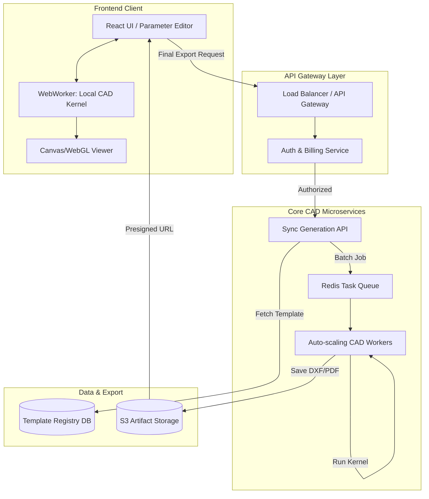

# PHASE 15 — PRODUCTION CAD PLATFORM (DIECUTTEMPLATES-LEVEL SYSTEM)

## 1. TEMPLATE ENGINE SYSTEM
The platform hosts a centralized registry of parametric models, strictly versioned to guarantee determinism.

*   **FEFCO Registry**: Standard corrugated box layouts (e.g., FEFCO 0201, 0427, 0422).
*   **ECMA Registry**: Standard folding carton layouts for paperboard (e.g., ECMA A20.20).
*   **Custom Registry**: Bespoke, user-saved parametric graphs.

**Template Data Structure:**
*   `id`: UUID / Catalog Code (e.g., `fefco-0427`).
*   `parameters`: Schema defining inputs (e.g., L, W, D, Caliper) with Min/Max bounds.
*   `constraints`: Rule engine definition for manufacturing limits (e.g., `Flap >= 15mm`).
*   `geometryBuilder`: Pure function `f(P) -> GeometryGraph`.
*   `exportRules`: Layer mapping for DXF and CSS classes for SVG (Cut=Red, Crease=Green).

## 2. CLOUD GENERATION API
A RESTful stateless microservice architecture for dieline generation.

**Endpoints:**
*   `GET /api/v1/templates` - Lists available parametric models and their input schemas.
*   `GET /api/v1/templates/:id` - Returns schema and metadata for a specific template.
*   `POST /api/v1/generate` - Synchronous generation for single requests.
    *   *Request Payload*: `{ "templateId": "fefco-0427", "params": {"L": 200, "W": 150, "D": 50, "T": 1.5}, "format": ["SVG", "DXF"] }`
    *   *Response*: Presigned S3 URLs for the generated assets.
*   `POST /api/v1/batch-generate` - Asynchronous generation for bulk orders.
    *   *Request Payload*: Array of generate payloads.
    *   *Response*: `{ "jobId": "uuid" }` (Client polls or receives webhook).

## 3. EXPORT ENGINE
Derived strictly from the validated topological memory pool (DCEL).

*   **SVG (Print-Ready)**: Translates coordinates to XML. Maps topological edge flags (CUT, CREASE) to standardized stroke colors and dash arrays. 
*   **DXF (Manufacturing)**: Uses standard ASCII DXF format. Maps edges to `LINE` and `ARC` entities. Organizes by layers (Layer 1 = Cut, Layer 2 = Crease).
*   **PDF (Preview & Pre-press)**: Embeds the SVG into a vector PDF context. Adds physical dimensions, title blocks, crop marks, and bleed zones automatically.
*   **JSON (CAD Hydration)**: Serializes the raw memory pool to allow a web viewer to load the fully evaluated graph without re-running the kernel.

## 4. BATCH PROCESSING SYSTEM
Designed for heavy industrial workloads (e.g., generating 10,000 variations of a box for ML training or catalog generation).

*   **Queue System**: Redis-backed message queue (BullMQ / Celery).
*   **Workers**: Auto-scaling pool of stateless Node.js / Go worker containers running the CAD Kernel.
*   **Job State Machine**: `QUEUED` $\to$ `PROCESSING` $\to$ `UPLOADED` $\to$ `COMPLETED` (or `FAILED`).
*   **Retry Mechanism**: 3x exponential backoff. If failure is due to geometric divergence (e.g., impossible parameters), it instantly hard-fails and writes a `ConstraintError` to the Dead Letter Queue.

## 5. UI CAD FRONTEND INTEGRATION
*   **Live Preview Strategy**: The Frontend loads the CAD Kernel natively in the browser via **WebAssembly (WASM)** or a Web Worker. As the user drags a slider, the local kernel evaluates the geometry at 60FPS.
*   **Cloud API Usage**: The backend API is ONLY invoked for the final, secure, high-resolution rendering and file export (DXF/PDF) to protect intellectual property and manage billing.
*   **Viewer**: An HTML5 Canvas or WebGL engine that renders the `SharedArrayBuffer` exposed by the local CAD Kernel worker. Supports pan, zoom, and dimension annotations.

## 6. PRICING & USAGE MODEL (SAAS BILING)
*   **Credits System**: Users purchase a block of credits (e.g., 100 credits = $50).
*   **Transaction**: Calling `POST /api/v1/generate` with a DXF format request deducts 1 credit. Previewing (SVG only) is free.
*   **API Rate Limiting**: Token-bucket algorithm via Redis. Standard tier = 60 requests/min. Enterprise tier = 1000 requests/min.

## 7. PERFORMANCE & SCALABILITY
*   **Stateless Processing**: The CAD Kernel has zero side-effects. Scaling horizontally is linear—just add more worker pods in Kubernetes.
*   **Memory Pooling**: Cloud workers initialize a long-standing `MemoryPool` upon boot. Each API request reuses this memory to prevent Node.js Garbage Collection pauses under heavy load.
*   **CDN Caching**: `GET /api/v1/templates` is aggressively cached at the edge (Cloudflare).

## 8. ERROR HANDLING (PRODUCTION)
*   **Job Failure Recovery**: If a worker pod dies mid-job, the queue automatically re-assigns the task.
*   **Invalid Geometry Fallback**: If a user requests a box with dimensions that physically self-intersect (e.g., Flaps overlap and crash the boolean engine), the API returns `422 Unprocessable Entity` with a detailed error payload indicating exactly which constraint failed.
*   **Safe Degraded Output**: For preview generation, if a complex cutout fails, the kernel can bypass the cutout and render the base bounding box with a red warning overlay.

## 9. SYSTEM GUARANTEES
*   **Absolute Determinism**: Generating FEFCO-0427 with params $[100, 50, 50]$ will produce the exact same byte-for-byte DXF output today, tomorrow, and across any server rack globally.
*   **Manufacturing Safety**: Zero-area faces, open topological loops, and duplicate lines are mathematically impossible to export.

## 10. SYSTEM ARCHITECTURE DIAGRAM

