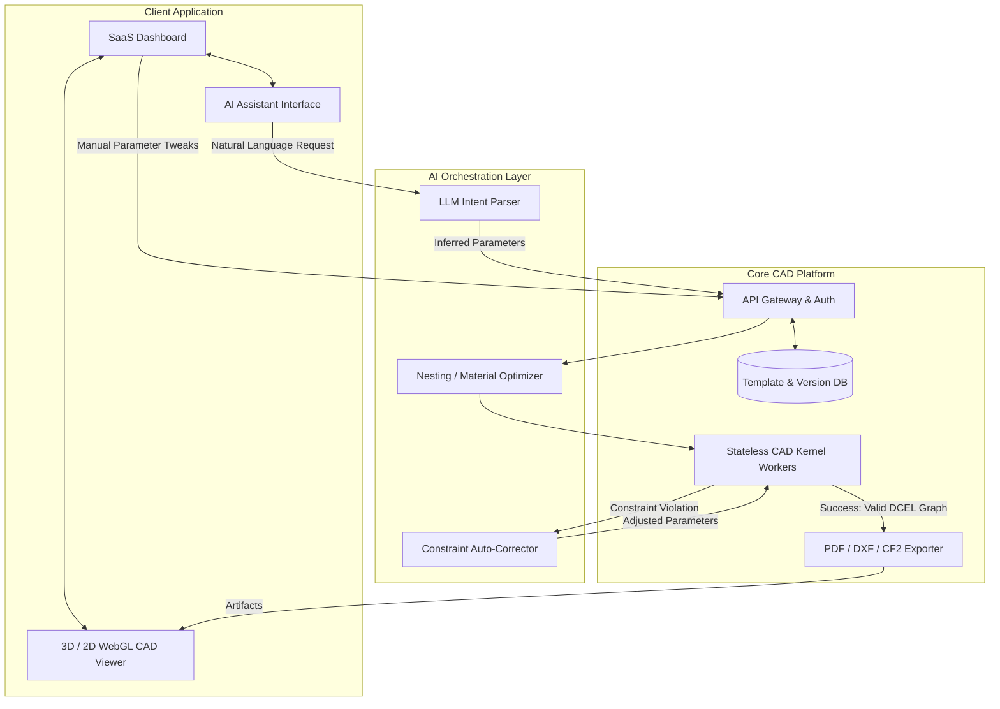

# PHASE 16 — DIECUTTEMPLATES-LEVEL + AI CAD SYSTEM (NEXT-GEN PLATFORM)

## OVERVIEW
This phase elevates the deterministic CAD Engine into a **Next-Gen AI-Enhanced SaaS Platform**. The platform exceeds legacy systems (DieCutTemplates, Packly) by wrapping the industrial-grade, mathematically strict CAD kernel in a cognitive AI orchestration layer. The AI **never** draws geometry directly; instead, it intelligently manipulates parameters, resolves constraints, and optimizes layouts via the deterministic CAD API.

## 1. AI PACKAGING ENGINE
The Cognitive Orchestration Layer acts as the bridge between human intent and the parametric engine.

*   **Natural Language to Dieline**: Users describe requirements (e.g., "I need a shipping box for a wine bottle, roughly 300mm tall and 80mm wide"). The AI parses this via an LLM, extracting intent and mapping it to a standard template (e.g., FEFCO 0201).
*   **Intelligent Auto-Correction**: If the CAD Kernel throws a `ConstraintViolationException` (e.g., glue tab overlaps dust flap), the error is caught by the AI. The AI reads the error context, adjusts the specific parameter by $\Delta$, and re-submits to the Kernel until convergence is achieved.
*   **Material Optimization (Nesting AI)**: Uses ML-based heuristic algorithms (like genetic algorithms or simulated annealing) to optimally rotate and pack multiple dieline instances onto a standard sheet size (e.g., $B1$ or $A0$) to minimize waste.

## 2. ADVANCED TEMPLATE INTELLIGENCE
Templates are no longer static schemas; they are dynamic, adaptive computational graphs.

*   **Parameter Inference**: If a user supplies only physical product dimensions (Length, Width, Height, Weight), the AI infers the necessary internal clearances, corrugated flute type (E-flute vs B-flute), and material thickness.
*   **Adaptive Flap Design**: Templates possess smart logic constraints. If a box is extremely shallow, the template automatically switches the closure mechanism from standard tuck flaps to friction-lock tabs to prevent unspooling.
*   **Smart Scaling**: Geometry isn't just stretched linearly. If a box scales up by $300\%$, lock-tab widths might hit a hard physical maximum (e.g., human fingers cannot open a $150\text{mm}$ tab), capping adaptively.

## 3. SMART CAD KERNEL INTEGRATION
**Core Rule: The AI does not draw. The Kernel draws.**

*   **Agentic Loop**:
    1. AI generates a `ParamPayload`.
    2. CAD Kernel executes the payload.
    3. Kernel returns `Success(Geometry)` OR `Error(ConstraintDetails)`.
    4. AI interprets the `Error`, modifies `ParamPayload`, and retries.
*   **Topological Feedback**: The CAD Kernel can pass structural feedback to the AI. E.g., "Face 4 is too narrow for standard gluing operations." The AI then suggests alternatives to the user.

## 4. CLOUD CAD PLATFORM (MULTI-TENANT SAAS)
A scalable enterprise architecture built for B2B and B2C clients.

*   **Multi-Tenant Architecture**: Logical separation of user data, saved projects, and proprietary custom templates via strict Row-Level Security (RLS) in the database (e.g., PostgreSQL / Supabase).
*   **Project & Versioning System**: Every dieline generation is saved as a deterministic JSON state (Template ID + Parameters + Seed). Users can branch designs, undo/redo, and maintain a history graph.
*   **White-Label API**: Enterprise clients (packaging manufacturers) can integrate the CAD engine directly into their own e-commerce platforms via a headless API.

## 5. INDUSTRIAL EXPORT SYSTEM
Outputs are strictly mapped to industry-standard protocols, guaranteeing zero-defect manufacturing.

*   **Print Houses**: PDF exports with strict CMYK color profiles, automated bleed zone generation ($+3\text{mm}$ offset from cut line), crop marks, and registration targets.
*   **Die-Cut Machines**: DXF (R12/R14 standard) outputs separated by CAD layers. All splines/Bézier curves are mathematically tessellated into bi-arc approximations to ensure compatibility with older CNC firmware.
*   **CF2 / CFF2**: Support for standard packaging CAD formats natively utilized by Esko ArtiosCAD and Zünd cutting tables.

## 6. PERFORMANCE AT SCALE
*   **Serverless CAD Computation**: The deterministic nature of the Kernel allows it to run on serverless edge functions or auto-scaling container fleets (e.g., AWS Lambda, Google Cloud Run) for massive parallel batch generation.
*   **Heuristic Caching**: If two users request a FEFCO 0427 with identical dimensions, the system bypasses the Kernel and serves the cached SVG/DXF artifacts directly from the CDN edge.
*   **WebSocket Live Engine**: For complex templates, the UI establishes a WebSocket connection to a persistent worker, allowing fluid, latency-free parametric scrubbing (slider dragging).

## 7. SYSTEM ARCHITECTURE DIAGRAM

## 8. COMPETITIVE ADVANTAGE SUMMARY
*   **Vs. DieCutTemplates / Packly**: Adds conversational AI, parametric inference, and intelligent auto-correction, lowering the barrier to entry for non-engineers while maintaining the same physical output quality.
*   **Vs. Esko ArtiosCAD**: Shifts the paradigm from a heavy, expensive, desktop-bound legacy C++ application to an instant, cloud-native, headless API capable of scaling infinitely, accessible from any browser.
