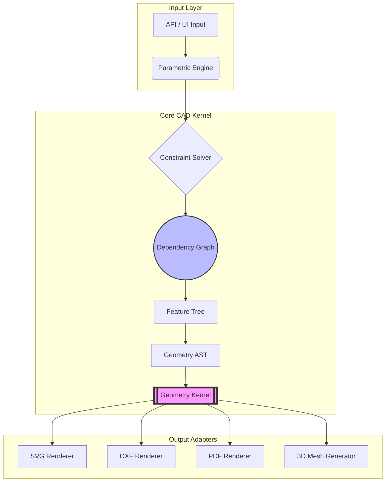

# PHASE 2 — CAD KERNEL DESIGN (FROM SVG SYSTEM TO TRUE CAD ENGINE)

## Executive Summary
This document outlines the architectural blueprint for transitioning the Packaging CAD platform from a reactive SVG generator into a true, industrial-grade **Geometry Object Model (GOM)**. This kernel is designed to rival professional systems like Esko ArtiosCAD, AutoCAD, and Impact CAD, acting as an independent, extensible, and mathematically rigorous calculation engine.

---

## 1. CORE PRINCIPLE SHIFT
**Legacy System:** `Parametric Math → Raw SVG Strings`
**Next-Gen System:** `Parametric Engine → Constraint Solver → Geometry AST → Geometry Kernel → Output Renderers`

The system no longer outputs "draw instructions". It now outputs a mathematically queryable **Geometry Object Model (GOM)** that can be intersected, offset, validated, and exported to any format.

---

## 2. GEOMETRY KERNEL
The lowest-level mathematical engine. It contains no concept of "boxes" or "flaps"—only pure mathematics.

**Core Entities:**
*   `Point`: (x, y, z)
*   `Line`: (Point A, Point B)
*   `Arc`: (Center, Radius, StartAngle, EndAngle)
*   `Curve / Spline`: (Bézier, NURBS, B-Splines for advanced die-cutting)
*   `Polygon`: Closed sequences of coplanar segments.
*   `Path`: Open or closed sequences of lines, arcs, and curves.
*   `Region`: A bounded 2D area (supports holes).

**Capabilities:**
*   **Boolean Operations**: Union, Difference, Intersection (via libraries like Clipper2 or robust half-edge data structures).
*   **Transformations**: Translation, Rotation, Scaling (using 4x4 Transformation Matrices).
*   **Offsetting**: Parallel path generation (tool radius compensation, kerf offsets).

---

## 3. GEOMETRY ABSTRACT SYNTAX TREE (AST)
An abstraction layer above the Geometry Kernel that represents the semantic meaning of the shapes. The AST is parametric, reactive, and fully serializable.

**Node Structure Example:**
```text
RootDielineNode
├── StructuralGroupNode (Base)
│   ├── PanelNode (Bottom)
│   │   ├── FoldNode (Front Crease)
│   │   ├── FoldNode (Back Crease)
│   │   └── CutNode (Side Slots)
│   └── PanelNode (Front)
│       └── GlueNode (Manufacturer's Joint)
├── BleedNode
└── SafeZoneNode
```
**Node Traits:**
*   **Reactive**: If a parent dimension changes, children recalculate automatically.
*   **Dependency-Aware**: Nodes subscribe to specific parameters in the Parametric Engine.

---

## 4. CONSTRAINT SOLVER
A dedicated engine to enforce physical, geometric, and manufacturing limitations without hardcoding formulas into the geometry.

**Constraint Types:**
*   **Geometric Constraints**: Parallelism, Perpendicularity, Tangency, Coincidence.
*   **Dimensional Constraints**: `Width > 0`, `Depth >= Flap * 2`.
*   **Material Constraints**: `BendAllowance = fn(Thickness, Flute)`.
*   **Manufacturing Constraints**: `GlueTab >= 15mm` (folder-gluer machine limit).

**Solver Mechanics:**
The solver evaluates equations mathematically (e.g., using a Newton-Raphson iterative solver or symbolic algebra engine) and updates the Dependency Graph.

---

## 5. DEPENDENCY GRAPH ENGINE
A Directed Acyclic Graph (DAG) that orchestrates the flow of data.

**Responsibilities:**
*   **Track Relationships**: Knows exactly which panels depend on the `Width` variable.
*   **Change Propagation**: When `Thickness` changes from 1.5mm to 3mm, only dependent AST nodes are marked as "dirty" (Dirty-Flag propagation).
*   **Auto-Recalculation**: Performs topological sorting to recalculate nodes in the exact correct order, ensuring O(1) evaluation where possible and preventing cyclic loops.

---

## 6. PARAMETRIC ENGINE
The central registry for all variables. No hardcoded magic numbers exist anywhere in the system.

**Capabilities:**
*   **Parameter Scoping**: Global parameters (L, W, D, Thickness) vs. Local parameters (Panel 3 width).
*   **Formula Evaluation**: Evaluates string-based or AST-based mathematical formulas (e.g., `(W / 2) - Thickness`).
*   **Version Control**: Captures a snapshot of all parameters at a given time for Undo/Redo or revision tracking.

---

## 7. FEATURE TREE
A SolidWorks-style hierarchical list of operations. This is the primary abstraction exposed to the user and the API.

**Features:**
*   `Panel(width, height, origin)`
*   `Flap(type, length, taperAngle)`
*   `GlueTab(width, angles)`
*   `Window(shape, x, y, size)`
*   `Fold(angle, allowance)`
*   `Cut(path)`

Features act as factories that generate the underlying Geometry AST nodes.

---

## 8. TEMPLATE SYSTEM (AS PARAMETRIC MODULES)
Templates are no longer static functions in a monolithic file. 
**Template = Parametric CAD Module**.

*   Each Template is a self-contained Class/Module.
*   Registers its required Parameters.
*   Registers its Rule & Constraints.
*   Constructs its Feature Tree.
*   **No Switch/Case logic**: The API dynamically instantiates the requested Template Module via a Registry Pattern.

---

## 9. RENDERING PIPELINE & ARCHITECTURE
The new flow decouples calculation completely from presentation.



---

## 10. THE STRICT ROLE OF THREE.JS
Three.js is strictly stripped of any geometrical generation logic. 
*   **Role**: Visualizer (View Layer).
*   **Input**: Consumes the exact 2D paths and fold hinge definitions outputted by the `3D Mesh Generator` adapter of the Geometry Kernel.
*   **Action**: It triangulates, applies textures, and rotates hinges. It does **not** calculate where the hinge should be or how long a flap is.
