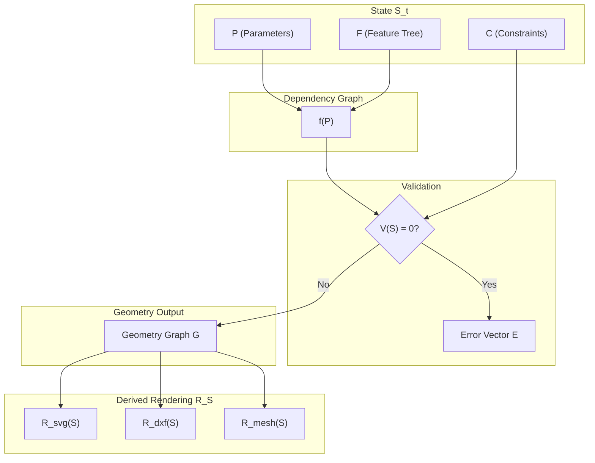

# PHASE 3 — MATHEMATICAL CAD KERNEL SPECIFICATION

## 1. GEOMETRY MATHEMATICAL MODEL

The foundational mathematical model is defined in the Euclidean plane $\mathbb{R}^2$ (with extension to $\mathbb{R}^3$ for normals/folding). 

### Primitive Set $\mathbb{P}$
Let $P, Q \in \mathbb{R}^2$ denote coordinate pairs.

*   **Point**: $p = (x, y) \in \mathbb{R}^2$
*   **Vector**: $\vec{v} = (v_x, v_y) \in \mathbb{R}^2$
*   **Line Segment**: $L(p_1, p_2) = \{ p_1 + t(p_2 - p_1) \mid 0 \le t \le 1 \}$
*   **Arc**: $A(c, r, \theta_1, \theta_2) = \{ c + r(\cos\theta, \sin\theta) \mid \theta \in [\theta_1, \theta_2] \}$
*   **Parametric Curve (Bézier)**: $C(T, \{p_i\}) = \sum_{i=0}^{n} \binom{n}{i} (1-t)^{n-i} t^i p_i, \quad t \in [0,1]$
*   **Polygon**: $\Pi(V) = \bigcup_{i=0}^{n-1} L(v_i, v_{i+1})$, where $V = \{v_0, v_1, \dots, v_{n-1}\}$ and $v_n = v_0$, bounding a closed region in $\mathbb{R}^2$.

---

## 2. GEOMETRY OPERATIONS (MATHEMATICAL)

Transformations are defined via affine mapping matrices $M \in \mathbb{R}^{3 \times 3}$ acting on homogeneous coordinates $(x, y, 1)^T$. Let $\Omega \subset \mathbb{P}$ be a geometric entity.

*   **Translate ($T_{\vec{v}}$)**:
    *   *Input*: $\Omega$, $\vec{v} = (d_x, d_y)$
    *   *Output*: $\Omega'$
    *   *Rule*: $p' = p + \vec{v}, \quad \forall p \in \Omega$
*   **Rotate ($R_{c, \theta}$)**:
    *   *Input*: $\Omega$, center $c = (c_x, c_y)$, angle $\theta$
    *   *Output*: $\Omega'$
    *   *Rule*: $p' = \begin{bmatrix} \cos\theta & -\sin\theta \\ \sin\theta & \cos\theta \end{bmatrix} (p - c) + c, \quad \forall p \in \Omega$
*   **Scale ($S_{c, s_x, s_y}$)**:
    *   *Input*: $\Omega$, center $c$, scalars $s_x, s_y$
    *   *Output*: $\Omega'$
    *   *Rule*: $p' = \begin{bmatrix} s_x & 0 \\ 0 & s_y \end{bmatrix} (p - c) + c, \quad \forall p \in \Omega$
*   **Mirror ($M_{L}$)**:
    *   *Input*: $\Omega$, reflection line $L_{ref}$ defined by $\vec{n} \cdot (p - p_0) = 0$
    *   *Output*: $\Omega'$
    *   *Rule*: $p' = p - 2(\vec{n} \cdot (p - p_0))\vec{n}, \quad \forall p \in \Omega$
*   **Offset ($O_d$)**:
    *   *Input*: Boundary $\partial\Omega$, distance $d$
    *   *Output*: $\partial\Omega'$
    *   *Rule*: $p'(t) = p(t) + d \cdot \vec{n}(t)$, where $\vec{n}(t)$ is the unit normal vector at parameter $t$.

### Boolean Operations (Set Theory)
Let $A, B \subset \mathbb{R}^2$ be closed geometric regions bounded by polygons or curves.

*   **Union ($\cup$)**:
    *   *Rule*: $A \cup B = \{ p \in \mathbb{R}^2 \mid p \in A \lor p \in B \}$
*   **Difference ($\setminus$)**:
    *   *Rule*: $A \setminus B = \{ p \in \mathbb{R}^2 \mid p \in A \land p \notin B \}$
*   **Intersection ($\cap$)**:
    *   *Rule*: $A \cap B = \{ p \in \mathbb{R}^2 \mid p \in A \land p \in B \}$

---

## 3. PARAMETRIC MODEL

Let $P$ be a vector of real-valued parameters:
$P = (p_1, p_2, \dots, p_n) \in \mathbb{R}^n$ (e.g., width, length, depth, material thickness).

Every geometric entity $G_i \in \mathbb{P}$ is defined as a continuous function $f_i$ mapped from the parameter space:
$$G_i = f_i(P)$$

No geometric coordinate is absolute. E.g., for a rectangular panel $R$:
$R_{width} = f_w(P) = p_{width} - 2 p_{thickness}$
$R_{height} = f_h(P) = p_{depth}$
$R = \Pi(\{(0,0), (R_{width}, 0), (R_{width}, R_{height}), (0, R_{height})\})$

---

## 4. CONSTRAINT SYSTEM

A constraint $C_j(P)$ restricts the valid domain of the parameter space $P$.

*   **Hard Constraints** (Must be satisfied, otherwise manufacturing is impossible):
    *   Equality: $C_j(P) = 0$
    *   Inequality: $C_k(P) \le 0$
    *   *Example*: $C_{glue}(P) = 15 - p_{glueTab} \le 0$ (Glue tab must be $\ge 15$ mm).
*   **Soft Constraints** (Optimizations, can be violated with a penalty):
    *   Penalty function: $\min \sum \lambda_j \Phi_j(P)$
    *   *Example*: $p_{aspectRatio} - 1.5 \approx 0$
*   **Conflict Resolution Strategy**:
    If $\bigcap \{P \mid C_{hard}(P) \le 0\} = \emptyset$ (over-constrained):
    The system minimizes the sum of squared constraint violations via Lagrangian Multipliers or Newton-Raphson approximation, prioritizing bounds of physical constraints (e.g., material thickness cannot change).

---

## 5. DEPENDENCY GRAPH MODEL

Let the system be a Directed Acyclic Graph (DAG) $G_{dep} = (N, E)$.
*   **Nodes $N$**: Set of parameters $P$ and evaluated geometric features $F$.
*   **Edges $E$**: $E \subseteq N \times N$. A directed edge $(u, v)$ means $v$ mathematically depends on $u$.

**Propagation Function:**
For a perturbation vector $\Delta P$ applied to $P$:
1. Identify perturbed subset $N_{dirty} \subset N$.
2. Compute topological ordering $O$ of the subgraph reachable from $N_{dirty}$.
3. For each node $v_i \in O$:
   $$v_i(t+1) = \text{eval}(f_{v_i}, \text{parents}(v_i, t+1))$$

---

## 6. FEATURE TREE MATHEMATICAL MODEL

A feature $F_k$ is a formal tuple defining a CAD operation.
$$F_k = \langle G_k, C_k, D_k \rangle$$
Where:
*   $G_k$: A set of parameterized geometric definitions $f(P)$.
*   $C_k$: A local subset of constraints applying to $G_k$.
*   $D_k$: Edges connecting $F_k$ to the Dependency Graph $G_{dep}$.

*Example (GlueTabFeature)*:
$G_k = \Pi(\dots)$ derived from adjacent panel edge.
$C_k = \{ \text{Width} \ge 3 \times \text{Thickness} \}$
$D_k = \{ \text{Depends on: AdjacentPanel, MaterialThickness} \}$

---

## 7. TEMPLATE AS FUNCTION

A structural Template $T$ is a pure mathematical mapping mapping an input parameter vector $P_{in}$ to a fully evaluated Geometry Graph $G_{out}$ (collection of regions, creases, and cuts).

$$T: \mathbb{R}^n \to \mathcal{G}$$
$$G_{out} = T(P_{in})$$

By definition, $T$ has no side effects. For the same parameter vector $P_{in}$, the identical boundary topology $\partial G_{out}$ is mathematically guaranteed.

---

## 8. STATE MODEL

The absolute state of the CAD Kernel at discrete time $t$ is the tuple:
$$S_t = \langle P_t, G_{dep, t}, C_{t}, \mathcal{F}_t \rangle$$

State transitions are deterministic functions mapping the current state and a parameter perturbation $\Delta p$ to the next state:
$$S_{t+1} = \Phi(S_t, \Delta p)$$

This strictly implies that history is a reversible sequence of discrete mathematical states, enabling absolute Undo/Redo without rendering artifacts.

---

## 9. RENDERING IS DERIVED

Rendering maps the abstract CAD state $S_t$ to specific presentation formats. The rendering function $\mathcal{R}$ is a pure projection:
$$\mathcal{R}: \mathcal{S} \to \{SVG, DXF, Mesh\}$$

*   $SVG = \mathcal{R}_{2D, DOM}(S_t)$
*   $DXF = \mathcal{R}_{2D, CAD}(S_t)$
*   $Mesh = \mathcal{R}_{3D}(S_t)$

Visual outputs are strictly derived corollaries of the underlying mathematical state.

---

## 10. VALIDATION MODEL

Validation is a decision function $\mathcal{V}$ classifying a given state $S$:
$$\mathcal{V}(S) : S \to \{0, 1\}$$

If $\mathcal{V}(S) = 0$ (invalid), it produces an error vector $E = \langle e_{overlap}, e_{constraint}, e_{manufacture} \rangle$.

*   **Overlap Error**: $e_{overlap} = \sum \text{Area}(G_i \cap G_j)$ for $i \neq j$ (Self-intersections).
*   **Constraint Error**: $e_{constraint} = \sum \max(0, C_k(P))$ (Violated geometric limits).
*   **Manufacturing Error**: $e_{manufacture}$ (e.g., $L > L_{machine\_max}$).

---

## SYSTEM DIAGRAM (MATHEMATICAL FLOW)

