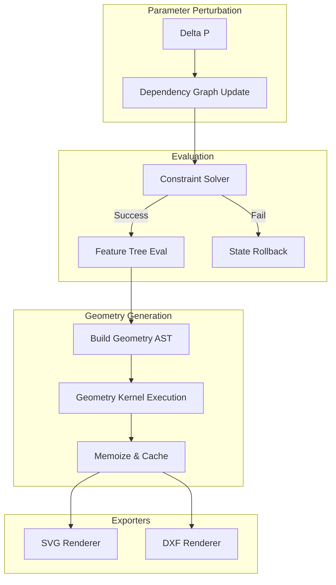

# PHASE 4 — CAD KERNEL ALGORITHMIC DESIGN (FROM THEORY TO EXECUTION MODEL)

## 1. GEOMETRY COMPUTATION ENGINE
The execution layer for purely geometric operations, operating strictly on exact or high-precision numerical representations to avoid floating-point drift.

**Computation Pipeline:**
1. **Input Reception**: Receive primitive definitions and transformation matrices.
2. **Numeric Promotion**: Convert standard IEEE 754 floating-point inputs into high-precision BigFloat or fixed-point integer representations (e.g., coordinates multiplied by $10^6$ for micrometric precision).
3. **Execution**: Apply affine transformations via matrix multiplication.
4. **Boolean Execution (Vatti / Weiler-Atherton algorithm)**:
   - *Phase 1 (Intersection)*: Find all intersections between subject and clip polygons using a sweep-line algorithm (Bentley-Ottmann).
   - *Phase 2 (Graph Construction)*: Build a doubly-connected edge list (DCEL).
   - *Phase 3 (Traversal)*: Traverse edges based on union/intersection/difference rules to extract the resulting boundary polygons.

**Precision Handling:**
- Strict separation of topological data (how vertices connect) and geometric data (where vertices are).
- $\epsilon$-tolerance rules: Two points $A$ and $B$ are merged if $|A - B| < 10^{-6}$ mm.

## 2. GEOMETRY GRAPH EXECUTION MODEL
The `GeometryGraph` represents operations as a Directed Acyclic Graph.

**Nodes**:
- `PrimitiveNode`: Instantiates raw geometric data (e.g., `Line(x1, y1, x2, y2)`).
- `TransformNode`: Applies an affine matrix $M$ to its children.
- `BooleanNode`: Performs Union/Difference/Intersection on two child subgraphs.
- `FeatureNode`: High-level wrapper containing specific parameterized logic.

**Execution Algorithm**:
```text
function evaluateGeometryGraph(node):
    if node is cached and !node.isDirty:
        return node.cachedGeometry
        
    inputs = []
    for child in node.children:
        inputs.push(evaluateGeometryGraph(child))
        
    geometry = node.compute(inputs)
    node.cachedGeometry = geometry
    node.isDirty = false
    return geometry
```

## 3. FEATURE TREE EXECUTION ENGINE
The Feature Tree maps user-level operations to the Geometry Graph.

**Traversal & Evaluation Algorithm (Hybrid Post-Order DFS)**:
1. **Traverse**: Start at the `RootDielineFeature`.
2. **Resolve Dependencies**: Before a feature computes, it recursively ensures its dependent features (e.g., the panel it attaches to) are fully evaluated.
3. **Compute Geometry**: The feature executes its parametric math to output a `GeometryGraph` subgraph.
4. **Constraint Application**: Apply local hard constraints. If violated, throw a `ConstraintViolationException`.
5. **Cache**: Store the resulting subgraph and mark the feature as clean.

## 4. CONSTRAINT SOLVER ALGORITHM
Resolves dynamic relationships and manufacturing limits.

**Solving Process**:
1. **Collection**: Aggregate all constraints $C$ from the Feature Tree.
2. **Classification**: Split into $C_{hard}$ (must equal 0 or $\le 0$) and $C_{soft}$ (optimization targets).
3. **Graph Construction**: Build a bipartite graph of Variables and Constraints to detect isolated solvable subgraphs.
4. **Resolution Strategy (Newton-Raphson Iteration)**:
   ```text
   function solveConstraints(V_initial, C_hard):
       V = V_initial
       while (max_violation(C_hard, V) > epsilon) and (iter < MAX_ITER):
           J = computeJacobian(C_hard, V)
           delta_V = pseudoInverse(J) * evaluate(C_hard, V)
           V = V - alpha * delta_V  // alpha is step size
           iter++
       
       if iter == MAX_ITER:
           throw OverConstrainedError()
       return V
   ```

## 5. DEPENDENCY GRAPH EXECUTION ENGINE
Manages state synchronization efficiently.

**Topological Sorting & Update Algorithm**:
1. **Dirty Flagging**: When parameter $P_k$ changes, mark $P_k$ and traverse forward to mark all dependent nodes as `DIRTY`.
2. **Topological Sort**: Extract the subgraph of `DIRTY` nodes and sort them topologically (Kahn's algorithm).
3. **Incremental Recomputation**:
   ```text
   queue = topologicalSort(dirtyNodes)
   while queue is not empty:
       node = queue.pop()
       node.evaluate()
       node.isDirty = false
   ```
*Strategy*: Lazy evaluation is used for geometry (only computed when render is requested), whereas Eager evaluation is used for constraints (fail fast).

## 6. PARAMETRIC RECOMPUTATION ENGINE
Handles the exact delta between state transitions.

**Algorithm:** `Recompute(S, \Delta p) \to S'`
1. Receive perturbation $\Delta p$ (e.g., `Width = 200`).
2. Inject $\Delta p$ into the Parametric Registry.
3. Trigger the Dependency Graph Execution Engine (flags nodes dirty and sorts).
4. Execute the Constraint Solver on the dirty subgraph to ensure $\Delta p$ doesn't violate rules.
5. If valid, commit $S'$ to the History Engine.
6. If invalid, reject $\Delta p$ and rollback to $S$.

## 7. TEMPLATE EXECUTION ENGINE
The orchestration pipeline that boots a CAD model.

**Execution Pipeline $T(p)$**:
1. **Initialization**: Instantiate empty Graph and Solver.
2. **Parameter Validation**: Check input $p$ against absolute template bounds (e.g., minimum viable box size).
3. **Feature Generation**: The template dynamically builds the Feature Tree based on $p$ (e.g., adding 4 panels and a glue tab).
4. **Dependency Binding**: Edges are drawn between features (Glue tab depends on Panel 1).
5. **Constraint Binding**: Template-specific manufacturing rules are injected into the Solver.
6. **Execution**: Trigger `Recompute()` to collapse the tree into the final `GeometryGraph`.

## 8. PRECISION & CAD ACCURACY MODEL
- **Tolerance**: Absolute spatial tolerance $\epsilon = 10^{-5}$ mm. 
- **Rounding Rules**: Intermediate calculations use 64-bit floats or arbitrary-precision rationals. Rounding to 3 decimal places occurs strictly at the Export phase.
- **Cumulative Error**: Prevented by utilizing local coordinate spaces for features and composing transformation matrices, rather than incrementally adding absolute coordinates.

## 9. MEMORY & PERFORMANCE MODEL
- **Caching Strategy**: Every `FeatureNode` and `GeometryNode` maintains a hash of its input parameters. Geometry is cached. If the hash matches on re-evaluation, the cached polygon is returned.
- **Incremental Update**: Only branches of the AST that are tainted by a parameter change are recalculated.
- **Memory Structure**: Geometry pooling. Instead of allocating thousands of new `Point` objects per frame, a flat typed array (e.g., `Float64Array`) stores coordinate buffers for high performance.

## 10. EXPORT DERIVATION MODEL
Deterministic transformation from the `GeometryGraph` to final outputs.

- **SVG Path Generation**: Traverse the final evaluated polygon boundaries. Map `Line` to `L`, `Arc` to `A`. Apply CSS classes based on metadata attached to the edges (e.g., `edge.type == CREASE -> stroke-dasharray`).
- **DXF Entity Generation**: Map AST nodes directly to standard DXF Entities (`LINE`, `ARC`, `POLYLINE`). Flatten all transformations to world coordinates.
- **3D Mesh Generation**:
  1. Earcut triangulation on the flat 2D boundary to create base polygons.
  2. Assign vertex groups based on fold lines.
  3. Apply rotation matrices to vertex groups around the fold hinge vectors based on folding angles.

## 11. FAILURE MODES & RECOVERY
- **Constraint Contradiction**: (e.g., `Width < 10` AND `Width > 50`).
  - *Recovery*: Solver halts, throws `ConstraintConflict`, and reverts to the last known valid state from the History Engine.
- **Geometry Invalid State**: (e.g., Self-intersecting outer boundary).
  - *Recovery*: Detected by the Collision Engine post-evaluation. Flags the exact intersecting nodes and visually highlights them, preventing export.
- **Dependency Cycles**: (e.g., A depends on B, B depends on A).
  - *Recovery*: Detected during Kahn's topological sort. Fails instantly during Template Execution.
- **Floating Point Drift**: 
  - *Recovery*: Snapping phase before boolean operations merges vertices within $\epsilon$ distance to ensure airtight polygons.


