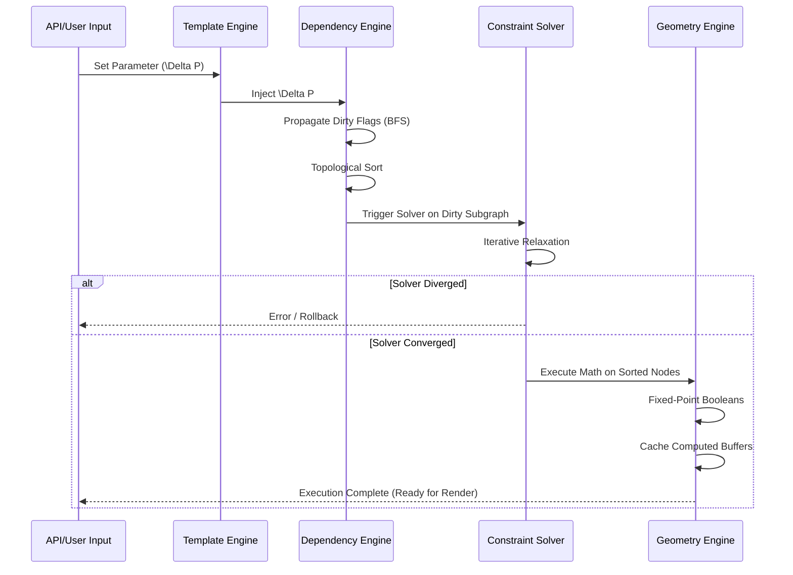

# PHASE 5 — REAL CAD KERNEL IMPLEMENTATION BLUEPRINT

## 1. GEOMETRY DATA STRUCTURE (CORE KERNEL)
The implementation requires a hybrid memory model: Objects for topology and structural relationships, and flat typed arrays for heavy numerical data to ensure cache locality and prevent Garbage Collection (GC) pauses.

### Node Data Structure (TypeScript Representation)
```typescript
enum NodeType { POINT, LINE, ARC, BOOLEAN_UNION, FEATURE_PANEL /*...*/ }

interface GeometryNode {
  readonly id: string;           // UUID or deterministic hash
  readonly type: NodeType;       
  
  // Parametric Inputs
  parameters: Float64Array;      // Flat array of numerical parameters
  metadata: Map<string, any>;    // Non-numerical params (e.g. material type)
  
  // Graph Topology (Adjacency List)
  dependencies: string[];        // Array of incoming Node IDs
  dependents: string[];          // Array of outgoing Node IDs
  
  // Execution State
  version: number;               // Increments on parameter change
  isDirty: boolean;              // True if dependencies changed
  
  // Computed Output
  computedBuffer?: Float64Array; // Memory-pooled coordinate output [x1,y1, x2,y2...]
  boundingBox?: Float64Array;    // [minX, minY, maxX, maxY]
}
```

### Memory & Immutability Rules
- `GeometryNode` objects are **mutable only by the Execution Engine**.
- `computedBuffer` is written once per evaluation using an **Object Pool**. 
- Vertices are strictly stored in `Float64Array` (Structure of Arrays - SoA approach).

---

## 2. GEOMETRY GRAPH IMPLEMENTATION
Implemented as a Directed Acyclic Graph (DAG) using an **Adjacency List**.

- **Node Storage**: A flat `Map<string, GeometryNode>` for $O(1)$ lookups.
- **Edge Representation**: Stored directly in the `dependencies` and `dependents` string arrays on each node.
- **Traversal Engine**: 
  - Uses **Kahn’s Algorithm** for topological sorting.
  - Implements **Partial Recomputation**: Only nodes where `isDirty === true` are placed in the evaluation queue.

---

## 3. CONSTRAINT SOLVER IMPLEMENTATION DESIGN
The solver uses a **Hybrid Iterative Relaxation Engine** (similar to physics engines like Box2D, adapted for CAD).

### Solving Strategy
1. **Constraint Graph Building**: Extracts all `ConstraintNode` entities and their bound variables into a bipartite graph.
2. **Classification**: 
   - *Acyclic (Direct)*: Solved instantly via forward propagation.
   - *Cyclic (Coupled)*: Solved via the iterative engine.
3. **Solving Algorithm (Iterative Relaxation)**:
   - Uses **Gauss-Seidel Relaxation**.
   - Iterates over constraints, projecting variables to satisfy the constraint, repeating until the maximum violation is $< \epsilon$.

### Conflict & Rollback
- **Max Iterations**: If `iter > 256` and $\text{error} > \epsilon$, the solver declares **Divergence**.
- **Rollback System**: The system captures a `Float64Array` snapshot of all parameters before the solver runs. On divergence, memory is blitted back from the snapshot to restore the last valid state, and a `SolverDivergenceError` is thrown.

---

## 4. DEPENDENCY ENGINE (REAL IMPLEMENTATION)
Handles exact state synchronization across thousands of parametric nodes.

### Dirty Propagation Algorithm (BFS)
```text
function propagateDirtyFlag(changedNodeId):
    queue = [changedNodeId]
    while queue is not empty:
        currentId = queue.shift()
        node = graph.get(currentId)
        if not node.isDirty:
            node.isDirty = true
            node.version += 1
            for dependentId in node.dependents:
                queue.push(dependentId)
```

### Cycle Detection Mechanism
Integrated natively into the Kahn's Topological Sort phase.
- If `evaluatedNodes.length !== dirtyNodes.length` after sorting, a cycle exists. The engine halts and reverts.

---

## 5. CAD PRECISION SYSTEM (CRITICAL)
Floating-point drift is the death of CAD booleans.

### Hybrid Precision Model
1. **Parametric Evaluation**: Uses `Float64` for trigonometric and algebraic formulas (e.g., evaluating $W \times \sin(\theta)$).
2. **Boolean Operations Core**: 
   - Inputs are scaled by $10^6$ and converted to **64-bit Integers** (Fixed-point grid).
   - $1 \text{ CAD Unit} = 10^{-6} \text{ mm}$.
   - Clipper2 or similar exact-integer boolean libraries are executed.
   - Results are scaled back to `Float64` for rendering.

### Snapping & Drift Prevention
- **Epsilon ($\epsilon$)**: defined as $10^{-5}$ mm.
- **Vertex Merging**: Before any Boolean operation, a spatial hash grid (cell size = $10^{-4}$) is used to snap vertices within $\epsilon$ distance to exactly the same integer coordinate.

---

## 6. FEATURE TREE IMPLEMENTATION
The structural abstraction defining the CAD logic.

### Tree Structure
A hierarchical composite pattern:
`FeatureTree` $\to$ `BoxAssembly` $\to$ `PanelNode` $\to$ `FlapNode` $\to$ `CutProfile`

### Evaluation Pipeline
1. **Pre-order Pass**: Inject parameters down the tree.
2. **Post-order Pass (Bottom-Up)**: Children evaluate their local geometry and pass `Float64Array` buffers up.
3. **Parent Assembly**: Parents perform Boolean Unions on child buffers to create the final continuous boundary.

### Caching Mechanism
- Each `FeatureNode` maintains a 64-bit hash of its input parameters (using MurmurHash3). 
- If the hash matches the previous frame, the evaluation is skipped entirely (O(1) cache hit).

---

## 7. TEMPLATE ENGINE IMPLEMENTATION
Templates are executed as pure generator functions.

### Execution Pipeline
1. **Module Loading**: Dynamically import `Template0427.ts`.
2. **Validation**: Check inputs against `Template.getBounds()` (e.g., Min Width).
3. **Graph Generation**: 
   - Template executes, calling `engine.addPanel()`, `engine.addGlueTab()`.
   - The engine constructs the `GeometryGraph` and `ConstraintGraph` in memory.
4. **Handoff**: The Template finishes. The underlying engine takes over the execution lifecycle.

---

## 8. MEMORY ARCHITECTURE
Optimized for zero-allocation during parametric scrubbing (e.g., sliding a "Width" slider at 60fps).

- **Typed Array Pooling**: `Float64Array` instances for geometry are acquired from a pre-allocated `BufferPool`.
- **Garbage Collection Evasion**: AST Nodes are never destroyed during parametric updates, only their `isDirty` flags and buffer values change.
- **Job Storage**: Serialized as a minimal JSON containing only `TemplateID` + `InputParameters`. The full graph is deterministic and re-instantiated on load.

---

## 9. EXECUTION PIPELINE (FULL SYSTEM)



---

## 10. FAILURE HANDLING SYSTEM
- **Geometry Corruption**: If Boolean ops fail (e.g., non-manifold geometry), the operation is caught, the specific node is flagged `ERROR_NON_MANIFOLD`, and a fallback bounding box is generated.
- **Solver Divergence**: Caught via max-iterations limit. Triggers memory copy rollback.
- **Dependency Cycles**: Caught by Topological Sort. Rejects the structural modification that introduced the cycle.

---

## 11. PERFORMANCE STRATEGY
- **Web Worker Offloading**: The entire CAD Kernel runs in a Web Worker, fully detached from the main UI thread.
- **SharedArrayBuffer (SAB)**: Computed geometry buffers (`Float64Array`) are backed by `SharedArrayBuffer`. The renderer reads these buffers directly without memory serialization/deserialization penalties.
- **Lazy Evaluation**: Raycasting or export operations (which require exact high-resolution curves) are evaluated lazily only when explicitly requested, while real-time preview evaluates a simplified LOD (Level of Detail) graph.
